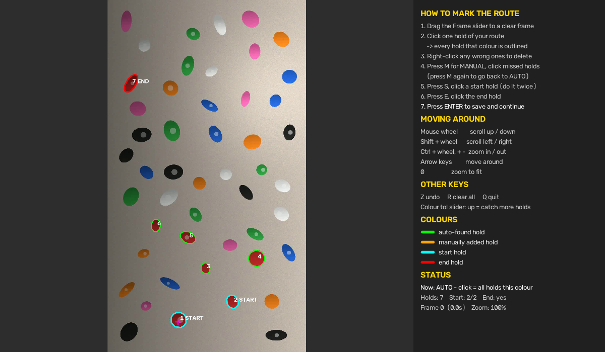
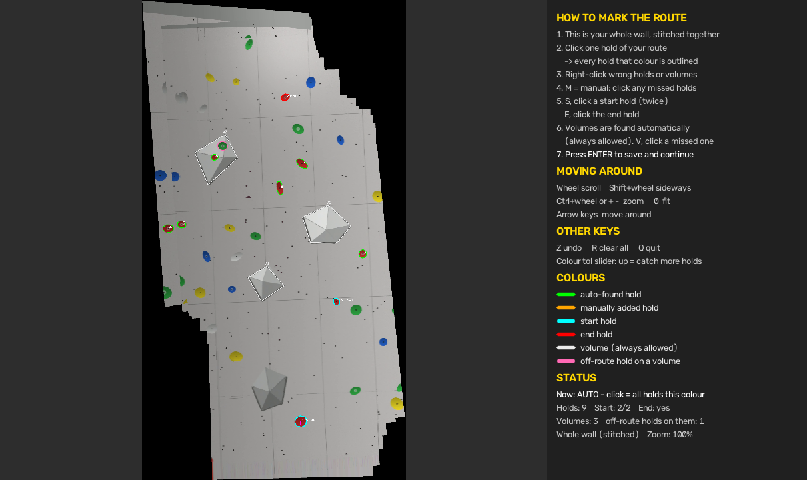
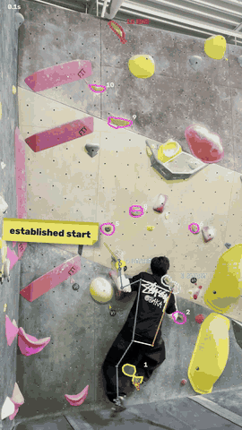
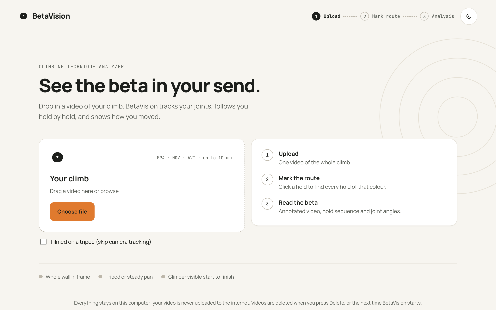

# BetaVision

**Computer-vision analysis of rock climbing videos.** Mark the holds of a route, and BetaVision finds the wall's volumes, follows the camera as it pans, tracks the climber's body through the video, lights up each hold as a hand or foot reaches it, and celebrates the top-out.

Built with Python, OpenCV and MediaPipe Pose.


*The hold picker: one click finds every hold of the route's colour. Volumes (white) are found automatically; holds on them that aren't the route's colour are cut out (pink). Start holds are cyan, the end hold is red. (Shown on a synthetic test wall.)*


*When the phone pans, the picker shows the whole wall stitched from the video, so a route taller than one frame can be marked in one place.*

## Demo

<p align="center"></p>

*A real climb, analyzed (shown at 2x speed). The route's holds are numbered with start holds in cyan and the end hold in red, the skeleton follows the climber, and each hold lights up yellow while a hand or foot is on it. The "footswap" and "dyno" sticky notes pin themselves to the holds in use at that moment. [Full-quality video (MP4)](docs/demo.mp4).*

---

## Features

- **Full-body pose tracking.** 16 climbing-relevant joints per frame (shoulders, elbows, wrists, hands, hips, knees, ankles, heels, toes) using MediaPipe Pose, drawn as a colour-coded skeleton (left side blue, right side orange).
- **One-click hold detection.** Click one hold and every hold of that colour is outlined. The clicked hold is outlined first and its colour is measured over the whole hold, leaving out chalk, highlights and shadow, so it doesn't matter where on the hold (or on which hold of the colour) you click; the clicked hold is always in the result. Matching runs in CIELAB space after flattening uneven gym lighting: same hue (within the clicked hold's own spread) and clearly more colourful than the wall around it, so dark or pale colours like navy and light blue don't pull in the wall, and pink/red or green/yellow stay apart.
- **Grey, white and black holds.** A hold counts as grey only if the clicked hold itself has no colour (a click on chalk or a highlight still reads the hold's colour). Grey holds are matched by how much brighter or darker than the surrounding wall they are, compared with the clicked one; patches that only just stand out (chalk smudges, lighter wall) are dropped.
- **The climber is never a hold.** MediaPipe's person mask (the same pose model as the tracking) is cut out of the picker frame, and a click on the climber is refused.
- **Clicks that add nothing say so.** Clicking a hold that's already selected, bare wall or the climber adds nothing and shows why. Clicking a *missed* hold of the route adds its shade to the match.
- **Deletes stay deleted.** Right-click removes the hold's whole outline from the match, so it doesn't come back when you change the colour tolerance or add clicks, and it never takes a neighbouring hold with it.
- **Automatic volume detection.** Volumes (the big grey geometric shapes) are always allowed on every route. BetaVision finds them from their sharp corners: it segments grey regions bounded by edges, keeps straight-sided polygons with few corners, merges touching faces, and follows long straight grey-on-grey edges (ignoring wall panel seams) to complete faces lit like the wall.
- **Coloured volumes follow gym rules.** Grey/neutral volumes are always allowed; a painted volume only counts if it's the route's colour (add one by hand with V/P to force it in).
- **Off-route holds on volumes are cut out.** A hold bolted onto a volume that differs from the volume's own colour (so painted volumes work too) is removed from the volume, so touching it still counts as off-route. Route holds on volumes are never cut.
- **Manual mode.** Click any hold the auto-detect missed and it is outlined on its own with GrabCut (foreground extraction), tried at three box sizes; a bigger box only wins if its outline follows clearly stronger edges without swallowing a different colour. Works for white/cream holds on light wood where colour alone fails. Right-click deletes false detections.
- **Start and end holds.** Tag up to two start holds and one end hold.
- **Handheld / panning video.** The camera is tracked frame by frame (Lucas-Kanade optical flow, chained homographies), with drift corrected every few frames by ORB feature matching against the marked frame or the last good checkpoint. Every hold and volume outline is warped into each frame, so outlines stay on their holds while the phone pans, tilts or zooms.
- **Whole-wall panorama.** If the camera moved, the frames are stitched into one picture of the whole wall (a per-pixel median, which also erases the climber) and the route is marked on that.
- **Contact detection.** Each hand and foot is matched to the nearest hold contour every frame, or to a volume if it isn't on a hold. Holds and volumes turn yellow while they're being used.
- **Possible off-route touches.** The picker also outlines the holds that *aren't* on the route: every hold-like blob of another colour on the wall (found with the same colour segmentation and climber mask as the route's holds, one colour model per hue seen on the wall), plus the off-route holds cut out of volumes. They follow the camera like the route does. A hand or foot is flagged only when it stays inside one of them for about 0.6 s or more *and* stays roughly still on the wall over that time (within ~3% of the frame, and not sliding along), so a limb swinging past in front of a hold isn't flagged; feet smearing on bare wall and anything on a volume are allowed. The hold is outlined orange-red with a *possible off-route* label for as long as the touch lasts, listed in the web app's results, and written to the CSV. Right-click a wrong off-route outline in the picker to remove it; `--no-off-route` (or the page's checkbox) turns the feature off.
- **Sticky-note annotations.** Add notes like `20-21 footswap`; each appears as a sticky note pinned to a hold for that time window and follows the hold if the camera moves. Without a hold number it pins itself to the hold in use then (feet for foot moves, hands for hand moves).
- **Top-out detection.** When both hands match on the end hold, a *CONGRATULATIONS!* banner appears with the time, and the hold overlays clear away.
- **Interactive picker UI.** Scrub through the video, zoom (up to 4x) and scroll to mark small holds precisely, undo any action, with an on-screen instructions panel.
- **Clean output.** Saves a single annotated video by default. Optional per-frame CSV (joint positions, elbow/knee/hip angles, which hold each limb is on, an `off_route_touch` column such as `l_foot:X3` while a possible off-route touch lasts, and each joint in wall coordinates, `<joint>_wx` / `<joint>_wy`, the pixels of the frame the route was marked in) with `--save-data`. New columns are always added at the end.
- **A library of recorded climbs.** After each analysis one small JSON climb record (no video or frames, a few tens of KB) is saved to `~/.climb_analyzer/library`: the route as marked (hold outlines and centres, start/end tags, volumes, in base-frame pixels and relative to the start-to-end extent), the hold sequence, possible off-route touches, whether and when you topped out, joint-angle ranges, and the video's name and date. Give the route a name and records of the same route are grouped (see [The climb library](#the-climb-library)). Opt out with `--no-record` or the page's checkbox.
- **Compare two climbs of the same route** (first version, see [Comparing two climbs](#comparing-two-climbs)). The second video can be filmed from elsewhere: its wall is matched to the first video's, the two climbs are lined up move by move with dynamic time warping, and you get a side-by-side video plus where the hold sequences, the time per move and the posture differ.

## How it works

```
video ──► camera tracking (optical flow + ORB re-anchoring) ─► homography per frame
            │  camera moved? ─► stitch whole-wall panorama
            ▼
          hold picker (OpenCV UI)
            │  click a hold ─► outline it, model its colour ─► hue / brightness match ─► holds + start/end tags
            │  automatic ─► grey polygons + straight edges ─► volumes (minus off-route holds)
            ▼
          MediaPipe Pose (VIDEO mode, frame by frame)
            │  33 landmarks ─► 16 joints, joint angles
            ▼
          outlines warped into each frame ─► contact check: hand/foot ↔ hold, else volume
            │  else inside an off-route hold? ─► held still ≥ ~0.6 s ─► possible off-route touch
            ▼
          annotated video: holds, skeleton, touched holds, off-route flags, top-out banner
```

| File | What it does |
|---|---|
| `climb_analyze.py` | **Main program.** Runs the hold picker, then tracks the climber and writes the annotated video. |
| `climb_holds.py` | Hold picker and hold detection (usable on its own). |
| `climb_volumes.py` | Volume detection and off-route hold cut-outs. |
| `climb_offroute.py` | Off-route holds on the wall and the rules for flagging a touch of one. |
| `climb_motion.py` | Camera tracking and whole-wall panorama stitching. |
| `climb_notes.py` | Sticky-note annotations. |
| `climb_compare.py` | Compares two climbs of the same route: wall registration, size-independent features, dynamic time warping, side-by-side video and summary. |
| `climb_pose.py` | Pose tracking only: skeleton video + per-frame CSV (usable on its own). |
| `betavision_app/` | Local web app: a small FastAPI server plus one web page, wrapping the same analysis code. |
| `run_betavision.bat` | Windows launcher for the web app (double-click). |

## Setup

Requires Python 3.10+ (tested on 3.13 and 3.14).

```bash
git clone https://github.com/matthewtang29/betavision.git
cd betavision
pip install -r requirements.txt
```

The pose model (~10–30 MB) downloads automatically on the first run into `~/.climb_analyzer/`.

## Usage

```bash
python climb_analyze.py my_climb.mov
```

1. **Mark the route** in the window that opens. If the camera moved, it shows the whole wall stitched together; otherwise a single frame:
   - (Single frame) drag the **Frame** slider to a clear, sharp frame.
   - **Click** one hold of the route. Every hold of that colour is outlined.
   - **Right-click** wrong detections to delete them. Press **M** and click any holds it missed.
   - Press **S** and click each start hold, then press **E** and click the end hold.
   - Volumes are outlined automatically. Right-click a wrong one to remove it. For a missed one press **V** and click it, or press **P** and click its corners for an exact outline (click the first corner again, or press Enter, to finish).
   - Holds of other colours are outlined thin orange-red: they're off-route, and resting a hand or foot on one is flagged. Right-click one that isn't really a hold (a sticker, a mat) to remove it, and right-click a pink cut-out on a volume that isn't a hold to put it back into the volume.
   - Press **Enter**.
2. Wait for tracking to finish. Output: `my_climb_analysis.mp4`.

### Picker controls

| Key / mouse | Action |
|---|---|
| Left click | AUTO: find all holds of this colour (a click on an already-selected hold, bare wall or the climber adds nothing) · MANUAL: add this one hold |
| Right click | Delete the hold (or volume) under the cursor; it stays deleted at any colour tolerance. On an off-route outline or a volume cut-out: remove just that |
| `M` | Switch AUTO / MANUAL |
| `S` / `E` | Next click tags a START / END hold |
| `V` | Next click auto-outlines a volume the auto-detect missed |
| `P` | Draw a volume by clicking its corners (Enter or first corner to finish, Esc to cancel) |
| Mouse wheel · Shift + wheel | Scroll up/down · left/right |
| Ctrl + wheel · `+` `-` | Zoom |
| Arrow keys · `0` | Pan · zoom to fit |
| `Z` · `R` · `Q` | Undo · clear all · quit |
| Enter | Save and continue |

### Sticky notes

Make a text file, one note per line:

```
# start-end   text            [@hold | @hand | @foot]
20-21         footswap
0:33-0:35     drop knee @5
0:10-0:12     match hands @V1
0:11-0:13     flag left foot           # "left foot" in the text = points at that foot
0:04-0:06     heel hook @rfoot
38.5-40       big move @hand
```

```bash
python climb_analyze.py my_climb.mov --notes my_notes.txt
python climb_analyze.py my_climb.mov --note "20-21 footswap"      # or one at a time
```

Hold numbers are the ones shown in the picker. To add notes without marking the route again, save the route once with `--save-data` and reuse it with `--holds my_climb_holds.json`.

### Options

```bash
python climb_analyze.py my_climb.mov --route-name "Blue wall V3"   # group this climb's record with others of the route
python climb_analyze.py my_climb.mov --no-record            # don't keep a climb record in the library
python climb_analyze.py my_climb.mov --save-data            # also save CSV + holds JSON/PNG
python climb_analyze.py my_climb.mov --holds my_climb_holds.json   # reuse marked holds
python climb_analyze.py my_climb.mov --model heavy          # more accurate, slower (lite/full/heavy)
python climb_analyze.py my_climb.mov --show                 # live preview while tracking
python climb_analyze.py my_climb.mov --still                # tripod video: skip camera tracking
python climb_analyze.py my_climb.mov --no-off-route         # don't flag touches of off-route holds
```

Saved `*_holds.json` files now also hold the off-route wall holds (`"off_route"`), so `--holds` reuses them. Files saved before this have none; they still load, and only the off-route cut-outs on volumes are checked.

### Comparing two climbs

Two videos of the same route (two climbers, or two of your attempts), and the route marked once on the first one:

```bash
python climb_analyze.py a.mov --save-data                     # mark the route on video A: a_holds.json
python climb_compare.py a.mov b.mov --holds a_holds.json      # compare B with A
python climb_compare.py a.mov b.mov --holds a_holds.json --data-a a_analysis.csv   # reuse A's pose
```

- **Video B can be filmed from anywhere** that shows the same wall. Wall features (the climbers masked out) are matched between a spread of frames of both videos and fitted with one homography, so the route doesn't have to be marked twice. If the wall can't be matched reliably (too few agreeing features, or matches that disagree with each other) it stops and says so instead of drawing the route in the wrong place.
- **Size doesn't matter.** Each frame is described by the hip centre's position on the route (as a fraction of the route's height), each hand and foot relative to the hips in torso lengths, the elbow/knee/hip angles measured on the wall, and which hold each limb is on.
- **Pacing doesn't matter.** Dynamic time warping lines the two climbs up so a slow and a fast climber are compared at the same point of the route. Walking up to the wall and stepping off are trimmed first (from a little before a hand first reaches a route hold to a little after the last one).
- **Outputs** (next to video A, or `--out`): `a_vs_b_compare.mp4`, both climbs side by side and in step, with B's skeleton drawn as a green ghost on A's wall; `a_vs_b_compare.json` and a printed summary: the hold sequence of each hand and foot and where they differ, the time each of A's moves took and how long B took over the same stretch, and the sections where the posture differs most (25° or more averaged over the six joint angles); `a_vs_b_registration.jpg`, the route drawn on video B. **Look at that picture first**: if the outlines aren't on the right holds, nothing else is trustworthy.
- Pose and camera tracking are cached in the output folder (`*_track_<model>.npz`, `*_cam_<frame>.npz`), so comparing the same videos again is quick.

In the web app, a finished analysis (with the route marked) has a *Compare with another climb* panel: choose the second video and you get the side-by-side video, the registration check picture and the same summary.

**State of this feature.** Tested on real footage only partly: there is no pair of videos of the *same route* in the test set yet. What was checked: the wall registration between two different real camera positions on the same wall (two clips of different routes, which line up to within a couple of pixels where the wall overlaps), and the whole comparison on one real climb against a copy of itself that was trimmed, played at a varying speed (0.3x to 1.5x) and seen through a different (synthetic) camera position: the alignment found the right frame to a median of 1 frame (90% within 5 frames, worst 11), the registration was within 2.5 px (median) of the true one, and the time per move matched the known timing except one move boundary during a rest. Comparing the same climber filmed two ways also showed how noisy the pose is between views: joint angles differ by up to ~20°, which is why posture sections start at 25°; one false section remained, at the drop-off after the top, where the alignment lags by ~0.25 s during fast movement. Two genuinely different climbers on one route are still to be tried.

## The climb library

Recording is on by default. This writes **outside the project folder**, so it has an opt-out: `--no-record` on the command line, the *Save this climb to my library* checkbox in the web app, or `BETAVISION_RECORD=0` to make the web app's checkbox start unticked. A record is one JSON file (`<id>.json`) with a `schema_version`; a record from a newer BetaVision than yours is skipped with a message rather than misread. Nothing is saved when no route was marked (there'd be nothing to learn from).

- **Where:** `~/.climb_analyzer/library` (next to the pose model). Change it with `--library DIR` or the `BETAVISION_LIBRARY` environment variable. The folder survives restarts, unlike the web app's `workspace/`. Delete a file to forget a climb.
- **Route names:** `--route-name "Blue wall V3"` or the page's *Route name* box (it suggests names already in the library). Names are matched ignoring capitals and extra spaces; records with the same name share a route id. A climb without a name is stored unnamed and is never grouped with others.
- **What's in a record:** the route (hold outlines, simplified, and centres, start/end roles, volumes), the moves (limb, hold or volume id, start time, duration; contacts under ~0.2 s are ignored, as in the results panel), possible off-route touches, whether and when you topped out, joint-angle ranges, video name and date, and when it was recorded.

Read it:

```bash
python climb_library.py list                    # every recorded climb, and the named routes
python climb_library.py route "Blue wall V3"    # a route with two or more records
```

For a named route with two or more records, `route` shows the hold sequence most climbs used for each hand and foot (holds from different records are matched by where they are relative to the route, not by number, because the picker numbers holds bottom to top and a missed hold shifts the rest) and the fastest climb that topped out, timed from the first hold contact to the top. The web app serves the same at `/api/library` and `/api/library/route?name=...`. That is all the "suggestion" there is so far: **learned beta suggestions need many more recorded climbs of a route than most people will have, so that roadmap item stays open.**

## Web app (Windows)

Prefer clicking to typing commands? BetaVision also runs as a local web app. It uses exactly the same analysis code, and everything stays on your computer: no cloud, no account.

**Setup (once):** install [Python 3.10+](https://www.python.org/downloads/) and tick *Add python.exe to PATH* in the installer.

**Launch:** double-click **`run_betavision.bat`**.

- The first launch creates a `.venv` folder next to the script and installs `requirements.txt` into it. This needs internet and takes a few minutes. Later launches start in seconds.
- Your browser opens at <http://127.0.0.1:8765>. Keep the black BetaVision window open while you use the app; close it to stop.

| Light mode | Dark mode |
|---|---|
|  |  |

**Use it:**

1. Drag a video (.mp4, .mov or .avi) onto the page, or click to browse. Tick *Filmed on a tripod* to skip camera tracking (same as `--still`).
2. BetaVision follows the camera. If it moved, it picks a few sharp frames that between them show the whole wall (a strip under the picture; **[** and **]** step through them). Mark each hold once, on whichever frame shows it best; holds found on one frame are shown on all of them. If the climber hides a hold on every one of them, drag the Frame slider to a better moment and click *Add this frame*. If the camera didn't move, you mark a frame you choose with the slider.
3. Mark the route just like the OpenCV picker: click one hold to find every hold of that colour, switch to *Just this hold* (**M**) for any it missed, right-click wrong holds or volumes, tag start (**S**) and end (**E**) holds. Volumes are found for you; add a missed one with **V** (click it) or **P** (click its corners). Scroll to zoom, drag to move. Or choose *Skip holds* to track the body only.
4. Optionally type sticky notes, one per line, in the same format as a notes file (see [Sticky notes](#sticky-notes)). Untick *Flag possible off-route touches* to turn that off (orange-red dashed outlines in the picker are the off-route holds; right-click a wrong one).
5. Click **Analyze climb**. When it's done you get the annotated video in the page, the results (how much of the climb was tracked, top-out time, holds used, the hold and volume sequence, possible off-route touches, where each note was pinned, joint angle ranges; click a move or a flag to jump there) and a **Download annotated video** button.

The options also have a *Route name* box and a *Save this climb to my library* checkbox (see [The climb library](#the-climb-library)); the results say whether the climb was saved.

Uploads and results are kept in a `workspace/` folder next to the app, which is emptied every time the app starts. Download anything you want to keep. The route you marked is saved there too as `<name>_holds.json`, reusable with the command line's `--holds`.

Manual start (any OS), from this folder with the requirements installed:

```bash
python -m betavision_app --open      # add --port 9000 to use another port
```

The command-line tool works exactly as before; the web app is an extra way in.

## Filming tips

- Handheld is fine: pan smoothly and keep plenty of wall in view (the wall is what the tracker locks onto).
- A tripod still gives the cleanest results; use `--still` to skip tracking.
- Film roughly straight-on to the wall.
- Good, even lighting improves both hold detection and pose tracking.

## Accuracy (synthetic test walls)

Measured on 16 generated walls with uneven lighting, chalk, panel seams, bolt holes and 3–4 multi-face volumes each (scripts not included):

| What | Result |
|---|---|
| Volumes found (10 walls not used for tuning) | 34 / 35, 0 false detections, ~89% outline overlap |
| Coloured holds found (red / blue / green), on wall and on volumes | 100% |
| Off-route holds on volumes cut out | 29 / 31, route holds wrongly cut: 0 / 36 |
| Grey holds found | ~46% (measured before the hold-segmenting picker; manual mode for the rest) |
| Outline position while panning (rough handheld shake, motion blur, zoom, tilt) | median ~2 px off, worst frame ~15 px; without tracking: ~500 px |
| Speed | volumes ~0.3 s per frame, holds: first click on a frame ~0.3–0.5 s (outlining the hold, finding the climber), each refresh after that ~0.05–0.1 s, camera tracking ~20 ms per frame, stitching ~5 s |

These are results on synthetic walls; real gym footage will vary. Off-route touch flags, checked frame by frame on three real handheld clips: one flag, correct (a hand resting on a white hold on a volume during a yellow route, 4 s); no false alarms on the other two, including a climber whose feet smear beside green holds. That's too few clips to give a rate. On 40 clicks across 6 real gym videos (`tools/eval_colour_pick.py`), the clicked hold was in the result every time.

## Limitations

- Grey/white holds that are almost exactly the wall's brightness can still be missed by auto-detect. Use manual mode for those. White holds also match white volumes and some highlights; right-click those.
- Grey/white/cream holds: the other holds of the colour are found less often than coloured ones (they must stand out from the wall about as much as the clicked one). Click a missed one to add it.
- Two holds of the same colour that touch come out as one outline.
- A painted volume of the route's colour (or one with streaks of it) can be partly matched as a hold.
- With a moving camera, a small hold can show up twice a few cm apart when the camera tracking is slightly off between two keyframes; deleting one removes both.
- Volume detection assumes grey volumes. Wooden or brightly painted volumes need to be added with **V**.
- Camera tracking assumes a flat wall. Strong overhangs or roofs filmed from close up bend the geometry and outlines can drift slightly.
- Very fast whip-pans with heavy motion blur can lose tracking for a moment.
- Top-out requires both hands matched on the end hold.
- Off-route flags are a hint, not a judgement: pose landmarks are 2D, so a hand or foot held still *in front of* a hold looks the same as one on it. The rules lean towards missing a touch rather than raising a false alarm: under ~0.6 s, a limb that slides slowly across a hold, or one within ~2% of the frame of a route hold, isn't flagged.
- Only coloured off-route holds are found on the wall. White, grey and black ones are not (on volumes they are, as cut-outs). Colourful things that aren't holds (mats, tape, signs, clothes) can show up as off-route outlines; right-click them in the picker. Off-route holds the climber hides in every picker frame are missed.
- A painted volume of another colour is treated as an off-route hold if it's small enough to look like one.

## Roadmap

- [ ] Compare two climbers on the same route (normalized joints + dynamic time warping). First version in `climb_compare.py` and the web app; not yet tried on two climbs of the same route (see [Comparing two climbs](#comparing-two-climbs))
- [x] Volume detection, with off-route holds on volumes excluded
- [x] Flag off-route hold touches in the video
- [x] Camera-motion compensation (feature tracking / homography) and whole-wall panorama
- [ ] Native iOS app (Swift, AVFoundation, Apple Vision)
- [ ] Beta suggestions learned from recorded move sequences (recording and a first read side exist, see [The climb library](#the-climb-library); the learning needs many recorded climbs of a route)

## License

MIT, see [LICENSE](LICENSE).
