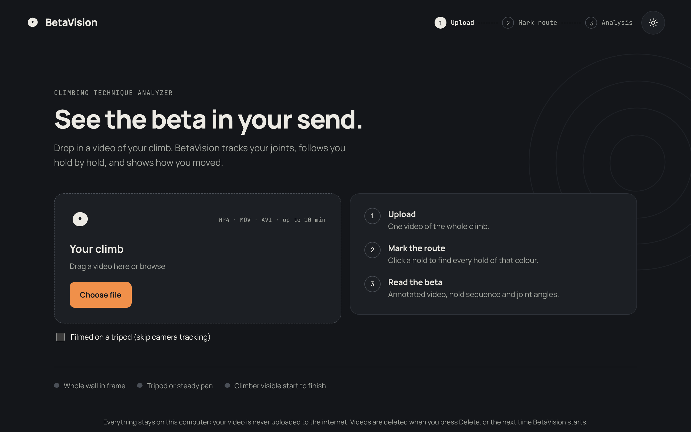

# BetaVision

[](https://github.com/matthewtang29/BetaVision/actions/workflows/tests.yml)

**Drop in a phone video of your climb and see your beta: every hold on the route outlined, your body tracked move by move, and each hold lighting up as you reach it. It all runs on your own computer.**

<p align="center"></p>

*A real climb, analyzed (2x speed). Start holds are cyan, the end hold is red, the skeleton follows the climber, and each hold turns yellow while a hand or foot is on it. [Full-quality video (MP4)](docs/demo.mp4).*

<!-- TODO: replace with a GIF of the web app in use: upload -> mark route -> results -->
<p align="center"><i>Web app walkthrough GIF coming soon.</i></p>

| Light mode | Dark mode |
|---|---|
|  |  |

## Features

- **One-click route marking.** Click one hold and every hold of that colour is outlined, even under uneven gym lighting. The clicked hold is outlined first and its colour is measured over the whole hold, ignoring chalk and highlights, so where you click doesn't matter. Matching is by hue and by how much a hold stands out from the wall around it, so navy or light blue don't pull in the wall and pink stays apart from red.
- **The climber is never a hold.** MediaPipe's person mask is cut out of the picker. A click on the climber, on bare wall or on a hold that's already selected adds nothing and says why, and right-click deletes stay deleted when you change the tolerance.
- **Volumes handled like gym rules.** The big geometric volumes are found automatically and always count; off-route holds bolted onto them are cut out.
- **Works with a handheld phone.** The camera is tracked frame by frame, so outlines stay on their holds while you pan, tilt or zoom. For a tall route, BetaVision picks a few sharp frames that between them show the whole wall.
- **Full-body pose tracking.** 16 climbing-relevant joints per frame, drawn as a skeleton (left side blue, right side orange), with elbow, knee and hip angles.
- **Hold-by-hold sequence.** Which hand or foot was on which hold, and when. Click a move to jump to it in the video.
- **Possible off-route touches.** Holds of other colours are outlined too. A hand or foot that rests on one for about 0.6 s, held still on the wall, is flagged in the video, the results and the CSV. A limb swinging past a hold, feet smearing on bare wall, and anything on a volume aren't flagged.
- **Compare two climbs of the same route.** The second video can be filmed from elsewhere: its wall is matched to the first video's, the two climbs are lined up move by move with dynamic time warping, and you get a side-by-side video plus where the hold sequences, the time per move and the posture differ.
- **A library of your climbs.** Each analysis saves a small record (no video) of the route and the hold sequence. Name the route and records of it are grouped, showing the sequence most climbs used and the fastest send.
- **Sticky notes.** Write `0:04-0:06 heel hook` and the note pins itself to the hold in use at that moment.
- **Top-out detection.** Both hands matched on the end hold triggers a *CONGRATULATIONS!* banner and the top-out time.
- **Two ways in.** A drag-and-drop web app that installs like a desktop app, or a command-line tool with an OpenCV picker window. Both use the same analysis code.
- **Private by design.** Nothing is uploaded anywhere (see [Privacy](#privacy)).

## Tech stack

| Area | Tools |
|---|---|
| Computer vision | OpenCV (CIELAB colour matching, GrabCut, Lucas-Kanade optical flow, ORB and SIFT features, homographies); dynamic time warping in NumPy |
| Pose estimation | MediaPipe Pose Landmarker |
| Web app | FastAPI + Uvicorn backend; vanilla JavaScript, HTML canvas and CSS frontend (no framework, no build step); installable PWA |
| Video | H.264 via Windows Media Foundation, or the bundled ffmpeg |
| Testing | pytest on Windows and Linux with GitHub Actions |

## Why I built it

I built BetaVision because I loved rock climbing with my high school friends, and being able to analyze how I climbed just means faster progress in the gym.

## How it works

```
video ──► camera tracking (optical flow + ORB re-anchoring) ─► homography per frame
            │  camera moved? ─► pick a few sharp keyframes that cover the whole wall
            ▼
          hold picker (web page or OpenCV window)
            │  click a hold ─► outline it, model its colour ─► hue / brightness match ─► holds + start/end tags
            │  other colours on the wall ─► off-route holds
            │  automatic ─► grey polygons + straight edges ─► volumes (minus off-route holds)
            ▼
          MediaPipe Pose (VIDEO mode, frame by frame)
            │  33 landmarks ─► 16 joints, joint angles
            ▼
          outlines warped into each frame ─► contact check: hand/foot ↔ hold, else volume
            │  else inside an off-route hold? ─► held still ≥ ~0.6 s ─► possible off-route touch
            ▼
          annotated video + hold sequence + off-route flags + per-frame CSV ─► climb library record
```

| File | What it does |
|---|---|
| `climb_analyze.py` | **Command-line entry point.** Runs the hold picker, then tracks the climber and writes the annotated video. |
| `climb_holds.py` | Hold detection and the OpenCV picker window. |
| `climb_volumes.py` | Volume detection and off-route hold cut-outs. |
| `climb_offroute.py` | Off-route holds on the wall and the rules for flagging a touch of one. |
| `climb_compare.py` | Compares two climbs of the same route: wall registration, size-independent features, dynamic time warping, side-by-side video and summary. |
| `climb_library.py` | The climb library: one small JSON record per analysis, and the `list` / `route` reports. |
| `climb_motion.py` | Camera tracking, keyframe choice and whole-wall panorama stitching. |
| `climb_notes.py` | Sticky-note annotations. |
| `climb_pose.py` | Pose tracking: skeleton, joint angles, model download. |
| `betavision_app/` | The local web app: a FastAPI server plus one page, wrapping the same analysis code. |
| `run_betavision.bat` | Windows launcher and installer for the web app. |
| `tests/` | pytest suite (web API, upload limits, CLI, caches, off-route rules, comparison, library). |
| `tools/` | Evaluation scripts: `eval_colour_pick.py` re-runs fixed hold clicks on real videos; `bench_lock_on.py` times hold lock-on. |

## How to run

You need [Python 3.10+](https://www.python.org/downloads/) (tested on 3.13 and 3.14). On Windows, tick *Add python.exe to PATH* in the installer.

### Web app on Windows (recommended)

1. Download or clone this repository.
2. Double-click **`run_betavision.bat`**.

The first run takes a few minutes and needs internet. It installs the Python packages into one shared place (`%LOCALAPPDATA%\BetaVision`) and adds **BetaVision** to the Start menu and the desktop. After that, open BetaVision from the Start menu like any other app: it opens in its own window in seconds. A new download of BetaVision reuses the same install and only installs packages again when `requirements.txt` changes.

A minimized BetaVision window in the taskbar runs the app. Close it to stop BetaVision.

> If Windows says it blocked the file, right-click the downloaded ZIP, choose **Properties**, tick **Unblock**, and extract it again.

### Web app on macOS / Linux

```bash
git clone https://github.com/matthewtang29/BetaVision.git
cd BetaVision
python -m venv .venv && source .venv/bin/activate
pip install -r requirements.txt
python -m betavision_app --window      # or --open for a normal browser tab
```

It runs at <http://127.0.0.1:8780> (or the next free port, if another program is using that one). In Chrome or Edge, click the install icon in the address bar to add it as an app; if BetaVision isn't running when you open the app, it tells you how to start it.

### Using the web app

1. **Upload:** drag in a video (.mp4, .mov, .m4v or .avi, up to 10 minutes and 2 GB). Tick *Filmed on a tripod* to skip camera tracking.
2. **Mark the route:** click one hold to find every hold of that colour. Switch to *Just this hold* (**M**) for any it missed, right-click wrong ones, and tag start (**S**) and end (**E**) holds. Add a missed volume with **V** (click it) or **P** (click its corners). If the camera moved, a strip of keyframes appears under the picture (**[** and **]** step through them).
   Holds of other colours show as thin orange-red dashed outlines: they're off-route. Right-click one that isn't really a hold (a sticker, a mat).
3. **Analyze:** pick a pose model, optionally type sticky notes and a route name, then click **Analyze climb**. You get the annotated video, the hold sequence, any possible off-route touches, joint angles, and downloads for the video and per-frame CSV. Untick *Flag possible off-route touches* or *Save this climb to my library* to turn those off.
4. **Compare (optional):** on the results page, *Compare with another climb* takes a second video of the same route and gives a side-by-side video, a registration check picture and a summary of the differences.

### Command line

```bash
pip install -r requirements.txt
python climb_analyze.py my_climb.mov
```

An OpenCV window opens to mark the route (same controls as the web app; press **Enter** when done).

 The output is `my_climb_analysis.mp4` next to the video. The pose model (10 to 30 MB) downloads once into `~/.climb_analyzer/`.

<details>
<summary>All command-line options, picker keys and sticky-note format</summary>

```bash
python climb_analyze.py my_climb.mov --save-data            # also save the CSV + holds JSON/PNG
python climb_analyze.py my_climb.mov --holds my_climb_holds.json   # reuse a marked route
python climb_analyze.py my_climb.mov --model heavy          # lite / full / heavy
python climb_analyze.py my_climb.mov --show                 # live preview while tracking
python climb_analyze.py my_climb.mov --still                # tripod video: skip camera tracking
python climb_analyze.py my_climb.mov --notes my_notes.txt   # sticky notes from a file
python climb_analyze.py my_climb.mov --note "20-21 footswap"
python climb_analyze.py my_climb.mov --no-off-route         # don't flag touches of off-route holds
python climb_analyze.py my_climb.mov --route-name "Blue wall V3"   # group this climb's library record with the route's others
python climb_analyze.py my_climb.mov --no-record            # don't keep a climb record in the library
```

Saved `*_holds.json` files also hold the off-route wall holds (`"off_route"`), so `--holds` reuses them; older files still load.

| Key / mouse | Action |
|---|---|
| Left click | AUTO: find all holds of this colour · MANUAL: add this one hold |
| Right click | Delete the hold (or volume) under the cursor |
| `M` | Switch AUTO / MANUAL |
| `S` / `E` | Next click tags a START / END hold |
| `V` | Next click outlines a volume the auto-detect missed |
| `P` | Draw a volume by clicking its corners (Enter or first corner to finish, Esc to cancel) |
| Mouse wheel · Shift + wheel | Scroll up/down · left/right |
| Ctrl + wheel · `+` `-` | Zoom |
| Arrow keys · `0` | Pan · zoom to fit |
| `Z` · `R` · `Q` | Undo · clear all · quit |
| Enter | Save and continue |

Sticky notes, one per line:

```
# start-end   text            [@hold | @hand | @foot]
20-21         footswap
0:33-0:35     drop knee @5
0:10-0:12     match hands @V1
0:04-0:06     heel hook @rfoot
38.5-40       big move @hand
```

Hold numbers are the ones shown in the picker. Without an `@`, a note pins itself to the hold in use at that moment.

</details>

## Comparing two climbs

Two videos of the same route (two climbers, or two of your attempts), and the route marked once on the first one:

```bash
python climb_analyze.py a.mov --save-data                     # mark the route on video A: a_holds.json
python climb_compare.py a.mov b.mov --holds a_holds.json      # compare B with A
python climb_compare.py a.mov b.mov --holds a_holds.json --data-a a_analysis.csv   # reuse A's pose
```

- **Video B can be filmed from anywhere** that shows the same wall. Wall features (the climbers masked out) are matched between a spread of frames of both videos and fitted with one homography, so the route doesn't have to be marked twice. If the wall can't be matched reliably (too few agreeing features, or matches that disagree with each other) it stops and says so instead of drawing the route in the wrong place.
- **Size doesn't matter.** Each frame is described by the hip centre's position on the route (as a fraction of the route's height), each hand and foot relative to the hips in torso lengths, the elbow/knee/hip angles measured on the wall, and which hold each limb is on.
- **Pacing doesn't matter.** Dynamic time warping lines the two climbs up so a slow and a fast climber are compared at the same point of the route. Walking up to the wall and stepping off are trimmed first (from a little before a hand first reaches a route hold to a little after the last one).
- **Outputs** (next to video A, or `--out`): `a_vs_b_compare.mp4`, both climbs side by side and in step, with B's skeleton drawn as a green ghost on A's wall; `a_vs_b_compare.json` and a printed summary: the hold sequence of each hand and foot and where they differ, the time each of A's moves took and how long B took over the same stretch, and the sections where the posture differs most (25° or more averaged over the six joint angles); `a_vs_b_registration.jpg`, the route drawn on video B. **Look at that picture first**: if the outlines aren't on the right holds, nothing else is trustworthy.
- Pose and camera tracking are cached in the output folder (`*_track_<model>.npz`, `*_cam_<frame>.npz`), so comparing the same videos again is quick.

In the web app, a finished analysis (with the route marked) has a *Compare with another climb* panel: choose the second video and you get the side-by-side video, the registration check picture and the same summary.

**State of this feature.** Tested on real footage only partly: there is no pair of videos of the *same route* in the test set yet. What was checked: the wall registration between two different real camera positions on the same wall (two clips of different routes, which line up to within a couple of pixels where the wall overlaps), and the whole comparison on one real climb against a copy of itself that was trimmed, played at a varying speed (0.3x to 1.5x) and seen through a different (synthetic) camera position: the alignment found the right frame to a median of 1 frame (90% within 5 frames, worst 11), the registration was within 2.5 px (median) of the true one, and the time per move matched the known timing except one move boundary during a rest. Comparing the same climber filmed two ways also showed how noisy the pose is between views: joint angles differ by up to ~20°, which is why posture sections start at 25°; one false section remained, at the drop-off after the top, where the alignment lags by ~0.25 s during fast movement. Two genuinely different climbers on one route are still to be tried.

## The climb library

Recording is on by default. This writes **outside the project folder**, so it has an opt-out: `--no-record` on the command line, the *Save this climb to my library* checkbox in the web app, or `BETAVISION_RECORD=0` to make the web app's checkbox start unticked. A record is one JSON file (`<id>.json`) with a `schema_version`; a record from a newer BetaVision than yours is skipped with a message rather than misread. Nothing is saved when no route was marked (there'd be nothing to learn from).

- **Where:** `~/.climb_analyzer/library` (next to the pose model). Change it with `--library DIR` or the `BETAVISION_LIBRARY` environment variable. The folder survives restarts, unlike the web app's `workspace/`. Delete a file to forget a climb.
- **Route names:** `--route-name "Blue wall V3"` or the page's *Route name* box (it suggests names already in the library). Names are matched ignoring capitals and extra spaces; records with the same name share a route id. A climb without a name is stored unnamed and is never grouped with others.
- **What's in a record:** the route (hold outlines, simplified, and centres, start/end roles, volumes), the moves (limb, hold or volume id, start time, duration; contacts under ~0.2 s are ignored, as in the results panel), possible off-route touches, whether and when you topped out, joint-angle ranges, video name and date, and when it was recorded.

Read it:

```bash
python climb_library.py list                    # every recorded climb, and the named routes
python climb_library.py route "Blue wall V3"    # a route with two or more records
```

For a named route with two or more records, `route` shows the hold sequence most climbs used for each hand and foot (holds from different records are matched by where they are relative to the route, not by number, because the picker numbers holds bottom to top and a missed hold shifts the rest) and the fastest climb that topped out, timed from the first hold contact to the top. The web app serves the same at `/api/library` and `/api/library/route?name=...`. That is all the "suggestion" there is so far: **learned beta suggestions need many more recorded climbs of a route than most people will have, so that roadmap item stays open.**

## Privacy

Your videos never leave your computer.

- The web app's server listens only on `127.0.0.1`, so other devices can't reach it, and it refuses requests from other websites.
- The page loads nothing from the internet (fonts are bundled). The only download is the pose model, once, from Google's MediaPipe model storage, and nothing about you or your videos is sent.
- Web app uploads and results are kept in a `workspace/` folder next to the app. **Delete this video** on the results page removes them at once; otherwise they are deleted the next time BetaVision starts. Download anything you want to keep.
- The command-line tool writes its output next to your video.
- The climb library keeps one small record per analysis (the route and the hold sequence, no video or pictures) in `~/.climb_analyzer/library`, outside the project folder. Turn it off with `--no-record` or the *Save this climb to my library* checkbox; delete a file there to forget a climb.

## Testing

```bash
pip install -r requirements.txt pytest httpx
python -m pytest -q tests
```

The tests generate a small synthetic wall video, so no footage is needed. GitHub Actions runs them on Windows and Linux, and checks that the Windows launcher sets up once and then reuses its install.

## Accuracy (synthetic test walls)

Measured on 16 generated walls with uneven lighting, chalk, panel seams, bolt holes and 3 to 4 multi-face volumes each:

| What | Result |
|---|---|
| Volumes found (10 walls not used for tuning) | 34 / 35, 0 false detections, ~89% outline overlap |
| Coloured holds found (red / blue / green), on wall and on volumes | 100% |
| Off-route holds on volumes cut out | 29 / 31, route holds wrongly cut: 0 / 36 |
| Grey holds found | ~46% (measured before the hold-segmenting picker; *Just this hold* for the rest) |
| Outline position while panning (rough handheld shake, blur, zoom, tilt) | median ~2 px off, worst frame ~15 px; without tracking: ~500 px |

Real gym footage will vary. On 40 clicks across 6 real gym videos (`tools/eval_colour_pick.py`), the clicked hold was in the result every time. Off-route touch flags, checked frame by frame on three real handheld clips: one flag, correct, and no false alarms; that's too few clips to give a rate.

## Limitations

- Grey, white and cream holds: other holds of that shade are found less often than coloured ones, and white holds can also match white volumes and highlights. Click a missed one to add it, right-click wrong ones, or use *Just this hold*.
- Two holds of the same colour that touch come out as one outline.
- A painted volume of the route's colour (or one with streaks of it) can be partly matched as a hold.
- With a moving camera, a small hold can show up twice a few cm apart when tracking is slightly off between two keyframes; deleting one removes both.
- Volume detection assumes grey volumes. Wooden or painted volumes need to be added with **V** or **P**.
- Camera tracking assumes a flat wall, so strong overhangs filmed from close up can make outlines drift slightly.
- Very fast whip-pans with heavy motion blur can lose tracking for a moment.
- Marking holds needs a mouse or touch screen; the rest of the web app works from the keyboard.
- Top-out requires both hands matched on the end hold.
- Off-route flags are a hint, not a judgement: pose landmarks are 2D, so a hand or foot held still *in front of* a hold looks the same as one on it. The rules lean towards missing a touch rather than raising a false alarm.
- Only coloured off-route holds are found on the wall; white, grey and black ones are not (on volumes they are, as cut-outs). Colourful things that aren't holds (mats, tape, signs) can show up as off-route outlines; right-click them in the picker.

## Roadmap

- [x] Volume detection, with off-route holds on volumes excluded
- [x] Camera-motion compensation and whole-wall route marking
- [x] Local drag-and-drop web app, installable like a desktop app
- [x] Flag off-route hold touches in the video
- [ ] Compare two climbers on the same route (normalized joints + dynamic time warping). First version in `climb_compare.py` and the web app; not yet tried on two climbs of the same route (see [Comparing two climbs](#comparing-two-climbs))
- [ ] Native iOS app (Swift, AVFoundation, Apple Vision)
- [ ] Beta suggestions learned from recorded move sequences (recording and a first read side exist, see [The climb library](#the-climb-library); the learning needs many recorded climbs of a route)

## License

MIT, see [LICENSE](LICENSE).
