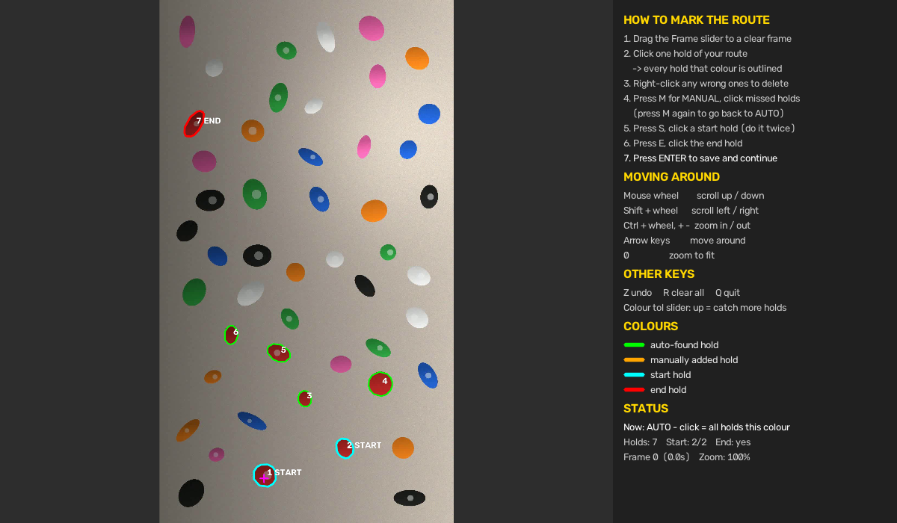
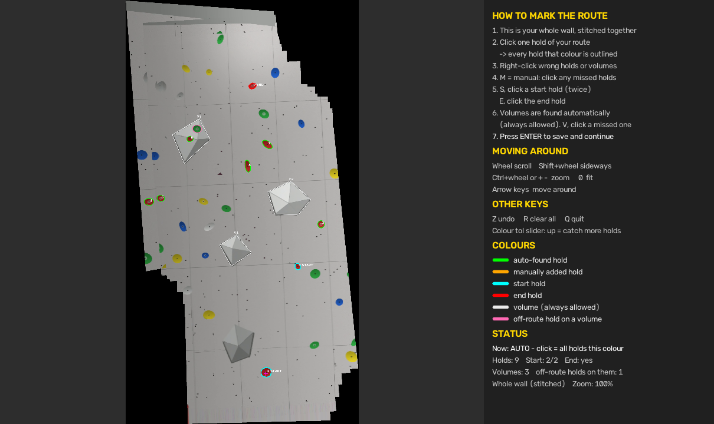
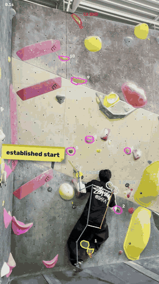
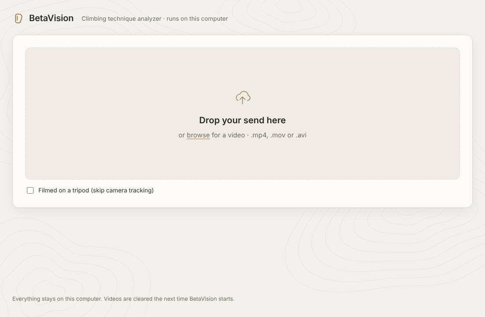
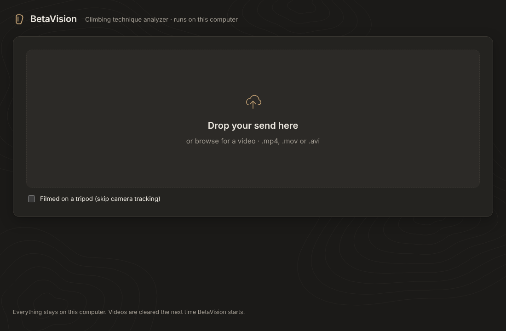

# BetaVision

**Computer-vision analysis of rock climbing videos.** Mark the holds of a route, and BetaVision finds the wall's volumes, follows the camera as it pans, tracks the climber's body through the video, lights up each hold as a hand or foot reaches it, and celebrates the top-out.

Built with Python, OpenCV and MediaPipe Pose.


*The hold picker: one click finds every hold of the route's colour. Volumes (white) are found automatically; holds on them that aren't the route's colour are cut out (pink). Start holds are cyan, the end hold is red. (Shown on a synthetic test wall.)*


*When the phone pans, the picker shows the whole wall stitched from the video, so a route taller than one frame can be marked in one place.*

## Demo

<p align="center"></p>

*A real climb, analyzed (shown at 2x speed). The route's holds are numbered with start holds in cyan and the end hold in red, the skeleton follows the climber, and each hold lights up yellow while a hand or foot is on it. The "footswap" and "dyno" sticky notes pin themselves to the holds in use at that moment. [Full-quality video (MP4)](docs/demo.mp4).*

---

## Features

- **Full-body pose tracking.** 16 climbing-relevant joints per frame (shoulders, elbows, wrists, hands, hips, knees, ankles, heels, toes) using MediaPipe Pose, drawn as a colour-coded skeleton (left side blue, right side orange).
- **One-click hold detection.** Click one hold and every hold of that colour is outlined. Colour matching runs in CIELAB space after flattening uneven gym lighting, so spotlights and dark corners don't break it. Sampling ignores chalk and bolt holes.
- **Grey, white and black holds.** The wall is grey too, so colour alone can't separate them. These are found by their outline instead: hold-sized curved edge arcs whose inside matches the clicked grey.
- **Automatic volume detection.** Volumes (the big grey geometric shapes) are always allowed on every route. BetaVision finds them from their sharp corners: it segments grey regions bounded by edges, keeps straight-sided polygons with few corners, merges touching faces, and follows long straight grey-on-grey edges (ignoring wall panel seams) to complete faces lit like the wall.
- **Coloured volumes follow gym rules.** Grey/neutral volumes are always allowed; a painted volume only counts if it's the route's colour (add one by hand with V/P to force it in).
- **Off-route holds on volumes are cut out.** A hold bolted onto a volume that differs from the volume's own colour (so painted volumes work too) is removed from the volume, so touching it still counts as off-route. Route holds on volumes are never cut.
- **Manual mode.** Click any hold the auto-detect missed and it is outlined on its own with GrabCut (foreground extraction), tried at three box sizes; a bigger box only wins if its outline follows clearly stronger edges without swallowing a different colour. Works for white/cream holds on light wood where colour alone fails. Right-click deletes false detections.
- **Start and end holds.** Tag up to two start holds and one end hold.
- **Handheld / panning video.** The camera is tracked frame by frame (Lucas-Kanade optical flow, chained homographies), with drift corrected every few frames by ORB feature matching against the marked frame or the last good checkpoint. Every hold and volume outline is warped into each frame, so outlines stay on their holds while the phone pans, tilts or zooms.
- **Whole-wall panorama.** If the camera moved, the frames are stitched into one picture of the whole wall (a per-pixel median, which also erases the climber) and the route is marked on that.
- **Contact detection.** Each hand and foot is matched to the nearest hold contour every frame, or to a volume if it isn't on a hold. Holds and volumes turn yellow while they're being used.
- **Sticky-note annotations.** Add notes like `20-21 footswap`; each appears as a sticky note pinned to a hold for that time window and follows the hold if the camera moves. Without a hold number it pins itself to the hold in use then (feet for foot moves, hands for hand moves).
- **Top-out detection.** When both hands match on the end hold, a *CONGRATULATIONS!* banner appears with the time, and the hold overlays clear away.
- **Interactive picker UI.** Scrub through the video, zoom (up to 4x) and scroll to mark small holds precisely, undo any action, with an on-screen instructions panel.
- **Clean output.** Saves a single annotated video by default. Optional per-frame CSV (joint positions, elbow/knee/hip angles, which hold each limb is on) with `--save-data`.

## How it works

```
video ──► camera tracking (optical flow + ORB re-anchoring) ─► homography per frame
            │  camera moved? ─► stitch whole-wall panorama
            ▼
          hold picker (OpenCV UI)
            │  click a hold ─► CIELAB colour match / outline arcs ─► holds + start/end tags
            │  automatic ─► grey polygons + straight edges ─► volumes (minus off-route holds)
            ▼
          MediaPipe Pose (VIDEO mode, frame by frame)
            │  33 landmarks ─► 16 joints, joint angles
            ▼
          outlines warped into each frame ─► contact check: hand/foot ↔ hold, else volume
            │
            ▼
          annotated video: holds, skeleton, touched holds, top-out banner
```

| File | What it does |
|---|---|
| `climb_analyze.py` | **Main program.** Runs the hold picker, then tracks the climber and writes the annotated video. |
| `climb_holds.py` | Hold picker and hold detection (usable on its own). |
| `climb_volumes.py` | Volume detection and off-route hold cut-outs. |
| `climb_motion.py` | Camera tracking and whole-wall panorama stitching. |
| `climb_notes.py` | Sticky-note annotations. |
| `climb_pose.py` | Pose tracking only: skeleton video + per-frame CSV (usable on its own). |
| `betavision_app/` | Local web app: a small FastAPI server plus one web page, wrapping the same analysis code. |
| `run_betavision.bat` | Windows launcher for the web app (double-click). |

## Setup

Requires Python 3.10+ (tested on 3.13 and 3.14).

```bash
git clone https://github.com/matthewtang29/betavision.git
cd betavision
pip install -r requirements.txt
```

The pose model (~10–30 MB) downloads automatically on the first run into `~/.climb_analyzer/`.

## Usage

```bash
python climb_analyze.py my_climb.mov
```

1. **Mark the route** in the window that opens. If the camera moved, it shows the whole wall stitched together; otherwise a single frame:
   - (Single frame) drag the **Frame** slider to a clear, sharp frame.
   - **Click** one hold of the route. Every hold of that colour is outlined.
   - **Right-click** wrong detections to delete them. Press **M** and click any holds it missed.
   - Press **S** and click each start hold, then press **E** and click the end hold.
   - Volumes are outlined automatically. Right-click a wrong one to remove it. For a missed one press **V** and click it, or press **P** and click its corners for an exact outline (click the first corner again, or press Enter, to finish).
   - Press **Enter**.
2. Wait for tracking to finish. Output: `my_climb_analysis.mp4`.

### Picker controls

| Key / mouse | Action |
|---|---|
| Left click | AUTO: find all holds of this colour · MANUAL: add this one hold |
| Right click | Delete the hold (or volume) under the cursor |
| `M` | Switch AUTO / MANUAL |
| `S` / `E` | Next click tags a START / END hold |
| `V` | Next click auto-outlines a volume the auto-detect missed |
| `P` | Draw a volume by clicking its corners (Enter or first corner to finish, Esc to cancel) |
| Mouse wheel · Shift + wheel | Scroll up/down · left/right |
| Ctrl + wheel · `+` `-` | Zoom |
| Arrow keys · `0` | Pan · zoom to fit |
| `Z` · `R` · `Q` | Undo · clear all · quit |
| Enter | Save and continue |

### Sticky notes

Make a text file, one note per line:

```
# start-end   text            [@hold | @hand | @foot]
20-21         footswap
0:33-0:35     drop knee @5
0:10-0:12     match hands @V1
0:11-0:13     flag left foot           # "left foot" in the text = points at that foot
0:04-0:06     heel hook @rfoot
38.5-40       big move @hand
```

```bash
python climb_analyze.py my_climb.mov --notes my_notes.txt
python climb_analyze.py my_climb.mov --note "20-21 footswap"      # or one at a time
```

Hold numbers are the ones shown in the picker. To add notes without marking the route again, save the route once with `--save-data` and reuse it with `--holds my_climb_holds.json`.

### Options

```bash
python climb_analyze.py my_climb.mov --save-data            # also save CSV + holds JSON/PNG
python climb_analyze.py my_climb.mov --holds my_climb_holds.json   # reuse marked holds
python climb_analyze.py my_climb.mov --model heavy          # more accurate, slower (lite/full/heavy)
python climb_analyze.py my_climb.mov --show                 # live preview while tracking
python climb_analyze.py my_climb.mov --still                # tripod video: skip camera tracking
```

## Web app (Windows)

Prefer clicking to typing commands? BetaVision also runs as a local web app. It uses exactly the same analysis code, and everything stays on your computer: no cloud, no account.

**Setup (once):** install [Python 3.10+](https://www.python.org/downloads/) and tick *Add python.exe to PATH* in the installer.

**Launch:** double-click **`run_betavision.bat`**.

- The first launch creates a `.venv` folder next to the script and installs `requirements.txt` into it. This needs internet and takes a few minutes. Later launches start in seconds.
- Your browser opens at <http://127.0.0.1:8765>. Keep the black BetaVision window open while you use the app; close it to stop.

| Light mode | Dark mode |
|---|---|
|  |  |

**Use it:**

1. Drag a video (.mp4, .mov or .avi) onto the page, or click to browse. Tick *Filmed on a tripod* to skip camera tracking (same as `--still`).
2. BetaVision follows the camera. If it moved, you mark the route on the whole wall stitched into one picture; otherwise on a frame you choose with the slider.
3. Mark the route just like the OpenCV picker: click one hold to find every hold of that colour, switch to *Just this hold* (**M**) for any it missed, right-click wrong holds or volumes, tag start (**S**) and end (**E**) holds. Volumes are found for you; add a missed one with **V** (click it) or **P** (click its corners). Scroll to zoom, drag to move. Or choose *Skip holds* to track the body only.
4. Optionally type sticky notes, one per line, in the same format as a notes file (see [Sticky notes](#sticky-notes)).
5. Click **Analyze climb**. When it's done you get the annotated video in the page, the results (how much of the climb was tracked, top-out time, holds used, the hold and volume sequence, where each note was pinned, joint angle ranges) and a **Download annotated video** button.

Uploads and results are kept in a `workspace/` folder next to the app, which is emptied every time the app starts. Download anything you want to keep. The route you marked is saved there too as `<name>_holds.json`, reusable with the command line's `--holds`.

Manual start (any OS), from this folder with the requirements installed:

```bash
python -m betavision_app --open      # add --port 9000 to use another port
```

The command-line tool works exactly as before; the web app is an extra way in.

## Filming tips

- Handheld is fine: pan smoothly and keep plenty of wall in view (the wall is what the tracker locks onto).
- A tripod still gives the cleanest results; use `--still` to skip tracking.
- Film roughly straight-on to the wall.
- Good, even lighting improves both hold detection and pose tracking.

## Accuracy (synthetic test walls)

Measured on 16 generated walls with uneven lighting, chalk, panel seams, bolt holes and 3–4 multi-face volumes each (scripts not included):

| What | Result |
|---|---|
| Volumes found (10 walls not used for tuning) | 34 / 35, 0 false detections, ~89% outline overlap |
| Coloured holds found (red / blue / green), on wall and on volumes | 100% |
| Off-route holds on volumes cut out | 29 / 31, route holds wrongly cut: 0 / 36 |
| Grey holds found | ~46% (manual mode for the rest) |
| Outline position while panning (rough handheld shake, motion blur, zoom, tilt) | median ~2 px off, worst frame ~15 px; without tracking: ~500 px |
| Speed | volumes ~0.3 s per frame, holds ~0.05 s per click, camera tracking ~20 ms per frame, stitching ~5 s |

These are results on synthetic walls; real gym footage will vary.

## Limitations

- Grey/white holds that are almost exactly the wall's brightness can still be missed by auto-detect. Use manual mode for those.
- Volume detection assumes grey volumes. Wooden or brightly painted volumes need to be added with **V**.
- Camera tracking assumes a flat wall. Strong overhangs or roofs filmed from close up bend the geometry and outlines can drift slightly.
- Very fast whip-pans with heavy motion blur can lose tracking for a moment.
- Top-out requires both hands matched on the end hold.

## Roadmap

- [ ] Compare two climbers on the same route (normalized joints + dynamic time warping)
- [x] Volume detection, with off-route holds on volumes excluded
- [ ] Flag off-route hold touches in the video
- [x] Camera-motion compensation (feature tracking / homography) and whole-wall panorama
- [ ] Native iOS app (Swift, AVFoundation, Apple Vision)
- [ ] Beta suggestions learned from recorded move sequences

## License

MIT, see [LICENSE](LICENSE).
