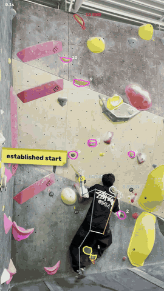
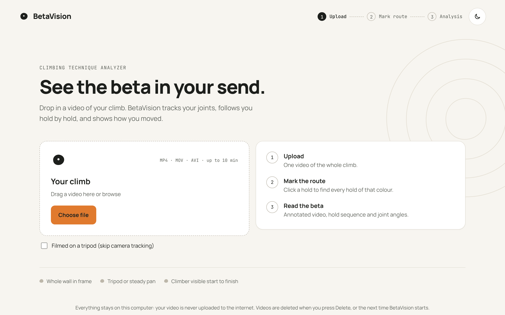
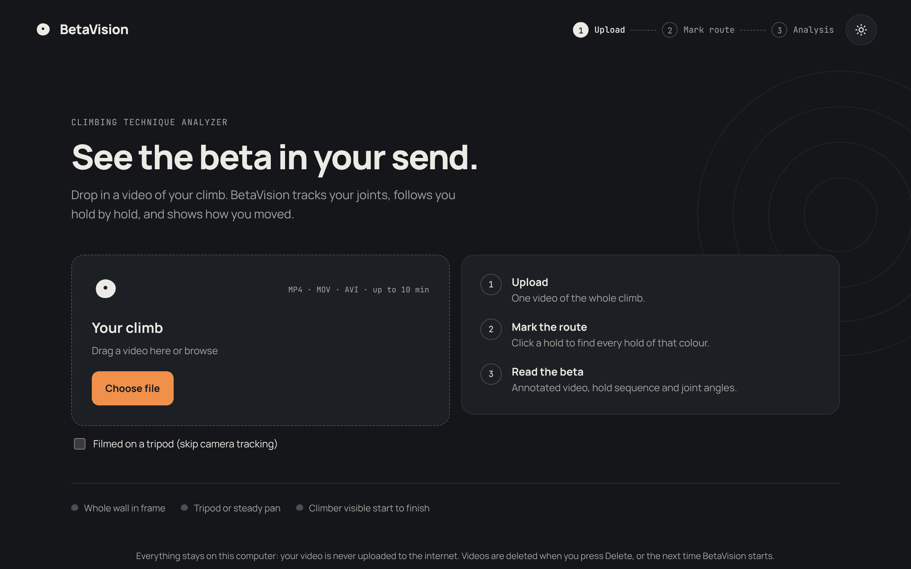
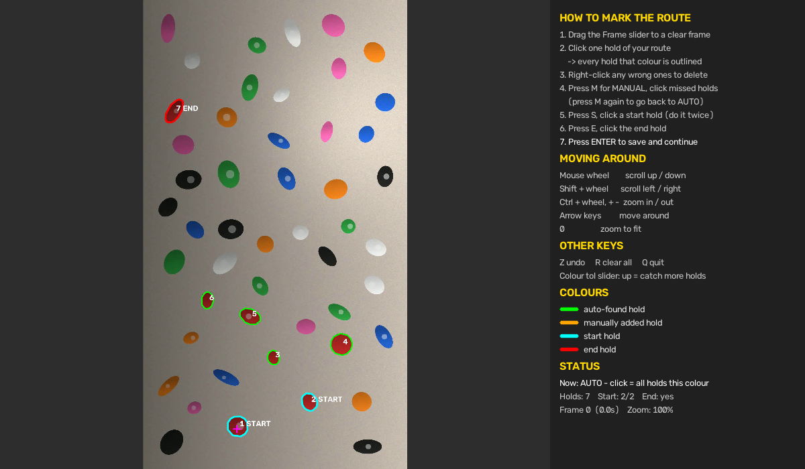

# BetaVision

[](https://github.com/matthewtang29/BetaVision/actions/workflows/tests.yml)

**Drop in a phone video of your climb and see your beta: every hold on the route outlined, your body tracked move by move, and each hold lighting up as you reach it. It all runs on your own computer.**

<p align="center"></p>

*A real climb, analyzed (2x speed). Start holds are cyan, the end hold is red, the skeleton follows the climber, and each hold turns yellow while a hand or foot is on it. [Full-quality video (MP4)](docs/demo.mp4).*

<!-- TODO: replace with a GIF of the web app in use: upload -> mark route -> results -->
<p align="center"><i>Web app walkthrough GIF coming soon.</i></p>

| Light mode | Dark mode |
|---|---|
|  |  |

## Features

- **One-click route marking.** Click one hold and every hold of that colour is outlined, even under uneven gym lighting. Grey and white holds, which colour alone can't separate from the wall, are found by their outline instead.
- **Volumes handled like gym rules.** The big geometric volumes are found automatically and always count; off-route holds bolted onto them are cut out.
- **Works with a handheld phone.** The camera is tracked frame by frame, so outlines stay on their holds while you pan, tilt or zoom. For a tall route, BetaVision picks a few sharp frames that between them show the whole wall.
- **Full-body pose tracking.** 16 climbing-relevant joints per frame, drawn as a skeleton (left side blue, right side orange), with elbow, knee and hip angles.
- **Hold-by-hold sequence.** Which hand or foot was on which hold, and when. Click a move to jump to it in the video.
- **Sticky notes.** Write `0:04-0:06 heel hook` and the note pins itself to the hold in use at that moment.
- **Top-out detection.** Both hands matched on the end hold triggers a *CONGRATULATIONS!* banner and the top-out time.
- **Two ways in.** A drag-and-drop web app that installs like a desktop app, or a command-line tool with an OpenCV picker window. Both use the same analysis code.
- **Private by design.** Nothing is uploaded anywhere (see [Privacy](#privacy)).

## Tech stack

| Area | Tools |
|---|---|
| Computer vision | OpenCV (CIELAB colour matching, GrabCut, Lucas-Kanade optical flow, ORB features, homographies) |
| Pose estimation | MediaPipe Pose Landmarker |
| Web app | FastAPI + Uvicorn backend; vanilla JavaScript, HTML canvas and CSS frontend (no framework, no build step); installable PWA |
| Video | H.264 via Windows Media Foundation, or the bundled ffmpeg |
| Testing | pytest on Windows and Linux with GitHub Actions |

## Why I built it

<!-- TODO(Matthew): replace this draft with your own 2-3 sentences. -->
When I climb, I film my attempts to work out what went wrong, but scrubbing through phone videos doesn't show much: it's hard to tell which hold my foot was actually on, or when my hips came away from the wall. I wanted a tool that turns that footage into something I can read, without uploading my videos to someone else's server.

## How it works

```
video ──► camera tracking (optical flow + ORB re-anchoring) ─► homography per frame
            │  camera moved? ─► pick a few sharp keyframes that cover the whole wall
            ▼
          hold picker (web page or OpenCV window)
            │  click a hold ─► CIELAB colour match / outline arcs ─► holds + start/end tags
            │  automatic ─► grey polygons + straight edges ─► volumes (minus off-route holds)
            ▼
          MediaPipe Pose (VIDEO mode, frame by frame)
            │  33 landmarks ─► 16 joints, joint angles
            ▼
          outlines warped into each frame ─► contact check: hand/foot ↔ hold, else volume
            ▼
          annotated video + hold sequence + per-frame CSV
```

| File | What it does |
|---|---|
| `climb_analyze.py` | **Command-line entry point.** Runs the hold picker, then tracks the climber and writes the annotated video. |
| `climb_holds.py` | Hold detection and the OpenCV picker window. |
| `climb_volumes.py` | Volume detection and off-route hold cut-outs. |
| `climb_motion.py` | Camera tracking, keyframe choice and whole-wall panorama stitching. |
| `climb_notes.py` | Sticky-note annotations. |
| `climb_pose.py` | Pose tracking: skeleton, joint angles, model download. |
| `betavision_app/` | The local web app: a FastAPI server plus one page, wrapping the same analysis code. |
| `run_betavision.bat` | Windows launcher and installer for the web app. |
| `tests/` | pytest suite (web API, upload limits, CLI). |

## How to run

You need [Python 3.10+](https://www.python.org/downloads/) (tested on 3.13 and 3.14). On Windows, tick *Add python.exe to PATH* in the installer.

### Web app on Windows (recommended)

1. Download or clone this repository.
2. Double-click **`run_betavision.bat`**.

The first run takes a few minutes and needs internet. It installs the Python packages into one shared place (`%LOCALAPPDATA%\BetaVision`) and adds **BetaVision** to the Start menu and the desktop. After that, open BetaVision from the Start menu like any other app: it opens in its own window in seconds. A new download of BetaVision reuses the same install and only installs packages again when `requirements.txt` changes.

A minimized BetaVision window in the taskbar runs the app. Close it to stop BetaVision.

> If Windows says it blocked the file, right-click the downloaded ZIP, choose **Properties**, tick **Unblock**, and extract it again.

### Web app on macOS / Linux

```bash
git clone https://github.com/matthewtang29/BetaVision.git
cd BetaVision
python -m venv .venv && source .venv/bin/activate
pip install -r requirements.txt
python -m betavision_app --window      # or --open for a normal browser tab
```

It runs at <http://127.0.0.1:8765>. In Chrome or Edge, click the install icon in the address bar to add it as an app; if BetaVision isn't running when you open the app, it tells you how to start it.

### Using the web app

1. **Upload:** drag in a video (.mp4, .mov, .m4v or .avi, up to 10 minutes and 2 GB). Tick *Filmed on a tripod* to skip camera tracking.
2. **Mark the route:** click one hold to find every hold of that colour. Switch to *Just this hold* (**M**) for any it missed, right-click wrong ones, and tag start (**S**) and end (**E**) holds. Add a missed volume with **V** (click it) or **P** (click its corners). If the camera moved, a strip of keyframes appears under the picture (**[** and **]** step through them).
3. **Analyze:** pick a pose model and optionally type sticky notes, then click **Analyze climb**. You get the annotated video, the hold sequence, joint angles, and downloads for the video and per-frame CSV.

### Command line

```bash
pip install -r requirements.txt
python climb_analyze.py my_climb.mov
```

An OpenCV window opens to mark the route (same controls as the web app; press **Enter** when done).

 The output is `my_climb_analysis.mp4` next to the video. The pose model (10 to 30 MB) downloads once into `~/.climb_analyzer/`.

<details>
<summary>All command-line options, picker keys and sticky-note format</summary>

```bash
python climb_analyze.py my_climb.mov --save-data            # also save the CSV + holds JSON/PNG
python climb_analyze.py my_climb.mov --holds my_climb_holds.json   # reuse a marked route
python climb_analyze.py my_climb.mov --model heavy          # lite / full / heavy
python climb_analyze.py my_climb.mov --show                 # live preview while tracking
python climb_analyze.py my_climb.mov --still                # tripod video: skip camera tracking
python climb_analyze.py my_climb.mov --notes my_notes.txt   # sticky notes from a file
python climb_analyze.py my_climb.mov --note "20-21 footswap"
```

| Key / mouse | Action |
|---|---|
| Left click | AUTO: find all holds of this colour · MANUAL: add this one hold |
| Right click | Delete the hold (or volume) under the cursor |
| `M` | Switch AUTO / MANUAL |
| `S` / `E` | Next click tags a START / END hold |
| `V` | Next click outlines a volume the auto-detect missed |
| `P` | Draw a volume by clicking its corners (Enter or first corner to finish, Esc to cancel) |
| Mouse wheel · Shift + wheel | Scroll up/down · left/right |
| Ctrl + wheel · `+` `-` | Zoom |
| Arrow keys · `0` | Pan · zoom to fit |
| `Z` · `R` · `Q` | Undo · clear all · quit |
| Enter | Save and continue |

Sticky notes, one per line:

```
# start-end   text            [@hold | @hand | @foot]
20-21         footswap
0:33-0:35     drop knee @5
0:10-0:12     match hands @V1
0:04-0:06     heel hook @rfoot
38.5-40       big move @hand
```

Hold numbers are the ones shown in the picker. Without an `@`, a note pins itself to the hold in use at that moment.

</details>

## Privacy

Your videos never leave your computer.

- The web app's server listens only on `127.0.0.1`, so other devices can't reach it, and it refuses requests from other websites.
- The page loads nothing from the internet (fonts are bundled). The only download is the pose model, once, from Google's MediaPipe model storage, and nothing about you or your videos is sent.
- Web app uploads and results are kept in a `workspace/` folder next to the app. **Delete this video** on the results page removes them at once; otherwise they are deleted the next time BetaVision starts. Download anything you want to keep.
- The command-line tool writes its output next to your video and nowhere else.

## Testing

```bash
pip install -r requirements.txt pytest httpx
python -m pytest -q tests
```

The tests generate a small synthetic wall video, so no footage is needed. GitHub Actions runs them on Windows and Linux, and checks that the Windows launcher sets up once and then reuses its install.

## Accuracy (synthetic test walls)

Measured on 16 generated walls with uneven lighting, chalk, panel seams, bolt holes and 3 to 4 multi-face volumes each:

| What | Result |
|---|---|
| Volumes found (10 walls not used for tuning) | 34 / 35, 0 false detections, ~89% outline overlap |
| Coloured holds found (red / blue / green), on wall and on volumes | 100% |
| Off-route holds on volumes cut out | 29 / 31, route holds wrongly cut: 0 / 36 |
| Grey holds found | ~46% (manual mode for the rest) |
| Outline position while panning (rough handheld shake, blur, zoom, tilt) | median ~2 px off, worst frame ~15 px; without tracking: ~500 px |

Real gym footage will vary.

## Limitations

- Grey or white holds almost exactly the wall's brightness can be missed by auto-detect. Use *Just this hold* for those.
- Volume detection assumes grey volumes. Wooden or painted volumes need to be added with **V** or **P**.
- Camera tracking assumes a flat wall, so strong overhangs filmed from close up can make outlines drift slightly.
- Very fast whip-pans with heavy motion blur can lose tracking for a moment.
- Marking holds needs a mouse or touch screen; the rest of the web app works from the keyboard.

## Roadmap

- [x] Volume detection, with off-route holds on volumes excluded
- [x] Camera-motion compensation and whole-wall route marking
- [x] Local drag-and-drop web app, installable like a desktop app
- [ ] Compare two climbers on the same route (normalized joints + dynamic time warping)
- [ ] Flag off-route hold touches in the video
- [ ] Native iOS app (Swift, AVFoundation, Apple Vision)

## License

MIT, see [LICENSE](LICENSE).
